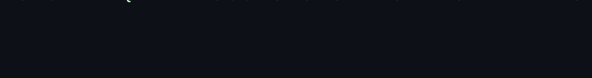

<!--
  bcneal666 — profile README
  COLOUR RULE (do not break):
    #00FF00 is the primary colour. Contrast is 1.37:1 on #ffffff (invisible) and
    13.7:1 on #0d1117. GitHub strips all CSS, so markdown text colour cannot be set.
    => EVERY green element must carry its own dark ground: an SVG whose root has
       background=0D1117, a shields capsule with labelColor/color=0D1117, or a card
       theme that paints a solid dark rect (chartreuse_dark paints #000).
    => Because nothing relies on the reader's theme colour, <picture> +
       prefers-color-scheme is NOT needed. Light and dark render identically.
  Section headings are readme-typing-svg images: it inlines Press Start 2P as a
    base64 @font-face, so the pixel font renders on every client. Heading text must
    stay ASCII — the font has no arrow/CJK glyphs and would render tofu. Headings
    sit flush to the left edge of the bar: SVG collapses leading whitespace, so a
    padded prefix has no effect — flush-left reads as a terminal prompt anyway.
    Trade-off accepted: headings are images, so there is no heading anchor. The alt
    text carries the semantics — never ship one of these without a descriptive alt.
  HARD RULE — a 200 is NOT a verification. Every SVG source here must parse as
    well-formed XML before it ships. A browser loading an SVG through  parses
    it STRICTLY: one malformed token and the whole image silently fails to render,
    with no console error and no clue in the response headers. Learned the hard
    way: readme-svg-typing-generator's matrix endpoint emits a BARE, unescaped
    ampersand among its rain glyphs (same byte offset on every request, at every
    width and height), so it returned a perfectly healthy 200 and rendered as a
    broken-image icon for everyone. Check with an XML parser, not with curl -w.
  tech-stack cards fail in TWO different ways, and only one of them is loud:
    - an unknown SHIELDS slug renders "404: badge not found" (loud). This is why
      the C# label must be DOUBLE-encoded as C%2523; a plain C%23 404s.
    - a slug shields knows but SIMPLE-ICONS does not renders a perfectly normal
      badge with NO LOGO (silent). simple-icons dropped `csharp` — it 404s on
      cdn.simpleicons.org — so C# now borrows the `dotnet` mark. `shadcn` is the
      same trap; the real slug is `shadcnui`.
    So verify a card by counting: the number of href="data:image/svg" occurrences
    must equal the number of badges. Checking only for "404: badge not found"
    misses every silent case.
    Also: fontFamily= is quoted as a family name, so the generic keyword
    'monospace' is invalid CSS there — pass a real face like Courier New.
  matrix.svg is ours, committed to this repo, precisely so no third party can
    break it again. Edit the file itself; the rules live in its header comment.
  assets/h-*.svg are the static ">_" section headings, downloaded once from
    readme-typing-svg (duration=1, so they never animate anyway) and committed for
    the same reason as matrix.svg. The font is already inlined, so they are
    self-contained. Regenerate by re-downloading with a new `lines=` value, then
    run them through an XML parser. Only the two animated hero lines still hit
    the live service.
  Contact is the issue form in .github/ISSUE_TEMPLATE/contact.yml — GitHub has no
    DMs and the profile deliberately exposes no email.
  Deliberately NOT used:
    readme-svg-typing-generator's matrix animation (invalid XML — see above; its
      other nine animations are well-formed, but this profile no longer needs them),
    github-readme-activity-graph (402 paywall on every host),
    github-profile-summary-cards + streak-stats (all repos are private — language
      cards count public repos only, streak needs private contributions exposed),
    github-readme-stats (503), github-profile-trophy (402), wakatime card (503),
    metrics.lecoq.io hosted instance (500), repobeats (500),
    ghchart.rshah.org (takes a custom hex, but hard-codes #EEEEEE for empty cells —
      a glaring pale grid on a dark theme, which breaks the colour rule above),
    capsule-render (emits <text> without inlining the font — pixel type falls back
      to the reader's system sans),
    plain markdown headings (cannot be coloured).
-->

- 🤖 **AI agents / LLM apps engineer.** I build agent and LLM products end to end — the model plumbing and the web app in front of it.
- 🧰 **What I build:** LLM agents, MCP tools and chat-bot backends, with Next.js + TypeScript front-ends and Node/MongoDB back-ends.
- 🧠 **Currently working on** LINE AI bots, agent tooling and a Claude Code workflow (see below).
- ⛓️ **Web3 on the side:** Solidity contracts with Hardhat and mocha tests.
- 💼 **Available for freelance and contract work** — [open a project inquiry](https://github.com/bcneal666/bcneal666/issues/new?template=contact.yml).

- **[.claude](https://github.com/bcneal666/.claude)** — My global Claude Code setup: custom skills, slash commands, hooks and a statusline. &nbsp;`Claude Code`&nbsp;`AI agents`&nbsp;`Hooks`&nbsp;`Skills`
- **[nvim](https://github.com/bcneal666/nvim)** — LazyVim-based Neovim config with blink.cmp, the Cyberdream theme and a full web-dev LSP stack, synced across Windows and a Linux VPS. &nbsp;`Neovim`&nbsp;`Lua`&nbsp;`LSP`

<!-- Regenerated daily by .github/workflows/snake.yml, published to the output branch. -->

